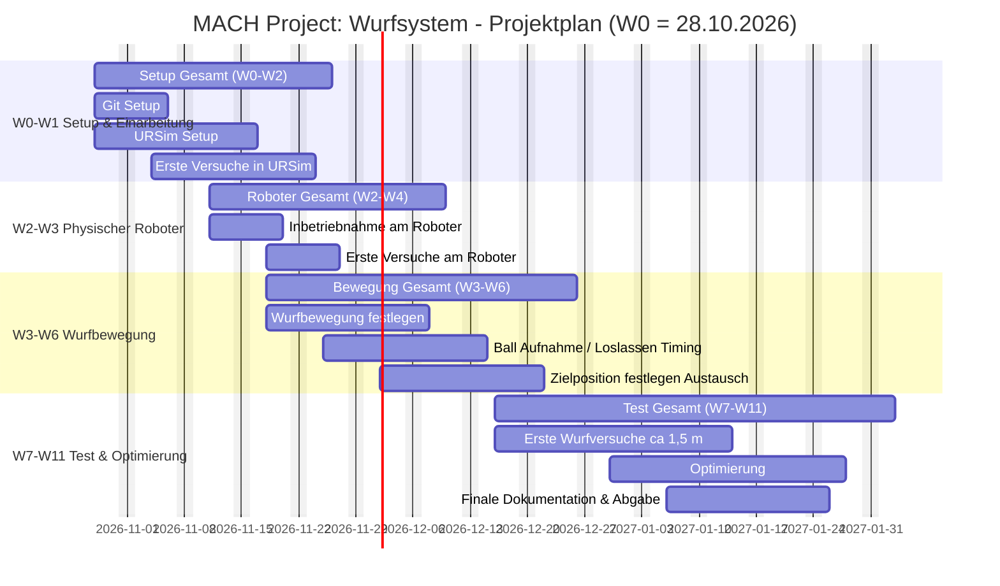

# Projektplan – MACH Wurfsystem

Gantt-Chart zur Zeiterfassung und Dokumentation. GitHub rendert dieses Diagramm nativ (Mermaid).

Wochenübersicht (Projektstart 28.10.2026 = W0):

| Woche | Datum |
|---|---|
| W0 | 28.10. – 03.11.2026 |
| W1 | 04.11. – 10.11.2026 |
| W2 | 11.11. – 17.11.2026 |
| W3 | 18.11. – 24.11.2026 |
| W4 | 25.11. – 01.12.2026 |
| W5 | 02.12. – 08.12.2026 |
| W6 | 09.12. – 15.12.2026 |
| W7 | 16.12. – 22.12.2026 |
| W8 | 23.12. – 29.12.2026 |
| W9 | 30.12. – 05.01.2027 |
| W10 | 06.01. – 12.01.2027 |
| W11 | 13.01. – 19.01.2027 |

## Meilensteine

| Meilenstein | Geplantes Datum | Woche |
|---|---|---|
| Repository eingerichtet | 28.10.2026 | W0 |
| URSim lauffähig | 10.11.2026 | W1 |
| Erste URSim-Versuche abgeschlossen | 24.11.2026 | W3 |
| Erste Versuche physischer Roboter | 25.11.2026 | W4 |
| Wurfbewegung definiert | 01.12.2026 | W5 |
| Ball Aufnahme / Loslassen (Timing) | 08.12.2026 | W6 |
| Zielposition (Austausch) definiert | 15.12.2026 | W7 |
| Erste Wurfversuche (ca. 1,5 m) | 06.01.2027 | W10 |
| Projekt abgeschlossen (Optimierung) | 19.01.2027 | W11 |

## So nutzt du das

1. Die Datei `PROJEKTPLAN.md` liegt im Repository (z. B. im Ordner `docs/projektplan-gantt`).
2. Auf GitHub rendert Mermaid automatisch – du siehst die Zeitleiste mit Datum und Wochen.
3. Bei Terminverschiebungen einfach die Daten anpassen, commiten und pushen.

Die geplanten Daten sind ab dem 28.10.2026 (W0) gesetzt – passe sie an euren tatsächlichen Projektstart und die Laborverfügbarkeit im MAIRo Lab an.